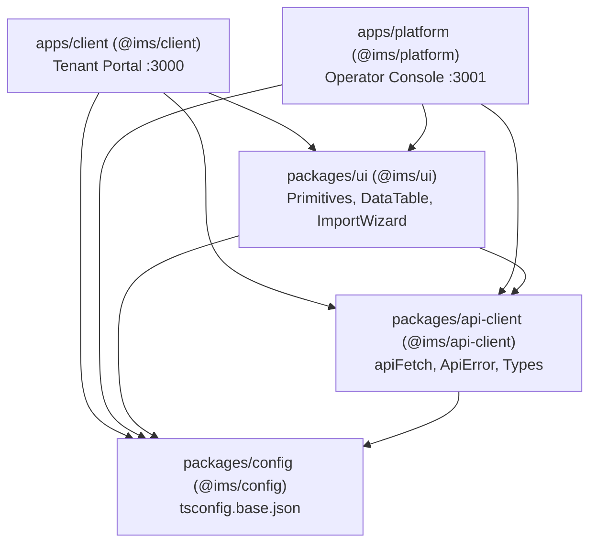

# 01 — Monorepo & App Architecture

`ims-portal` is a **pnpm workspace monorepo** (`pnpm@10.6.5`) separating tenant-facing workflows (`@ims/client`), operator workflows (`@ims/platform`), typed API communication (`@ims/api-client`), and reusable UI building blocks (`@ims/ui`).

---

## 1. Dependency Topology

---

## 2. Next.js App Router Structure (`apps/client`)

`apps/client` uses Next.js 15 App Router route groups to separate public authentication pages from session-protected workspace pages:

- **`app/(auth)/`**: Unauthenticated routes (`/login`, `/register`, `/accept-invite`, `/forgot-password`).
- **`app/(app)/`**: Protected workspace wrapped by `app/(app)/layout.tsx`:
  1. Server component checks `cookies()` for `ACCESS_COOKIE_NAME` (`__Host-ims_at` / `ims_at`) or `REFRESH_COOKIE_NAME` (`__Host-ims_rt` / `ims_rt`), redirecting to `/login` when absent.
  2. Wraps children in `EntitlementProvider` -> `EditModeProvider` -> `AppShell`.
- **`app/api/auth/*` & `app/api/v1/[...path]/route.ts`**: Next.js Route Handlers acting as the **Backend-for-Frontend (BFF)** proxy to `ims-core-management`.

---

## 3. Platform Operator App (`apps/platform`)

`apps/platform` is isolated on port `3001` (mounted under `/platform`) with its own BFF routes (`app/api/platform/v1/auth/login/route.ts` and `app/api/platform/[...path]/route.ts`) and dedicated `ims_platform_token` `HttpOnly` cookie, ensuring tenant sessions and operator sessions never share cookies or proxy routes.
