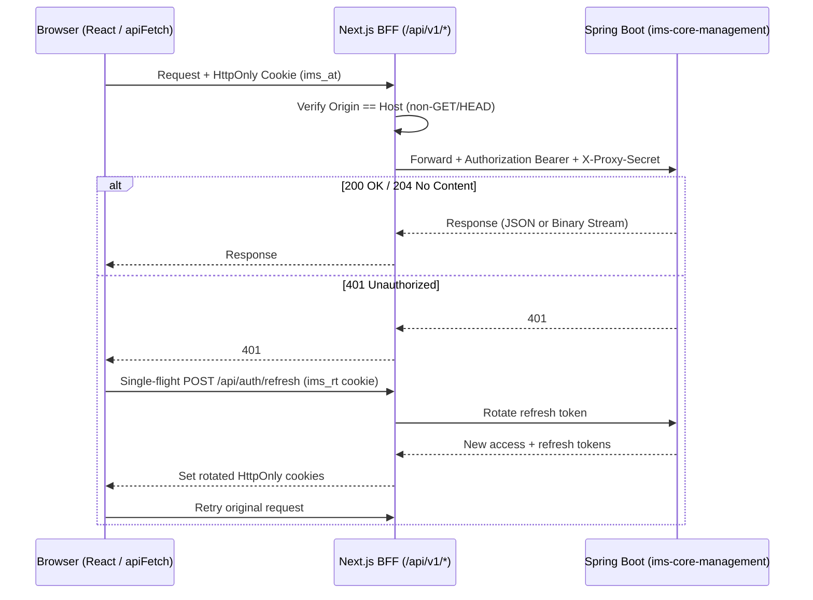

# 02 — BFF Auth & Security Model

Neither `@ims/client` nor `@ims/platform` ever exposes JWT access or refresh tokens to browser JavaScript (`localStorage`, `sessionStorage`, or `document.cookie`). All authentication and upstream API calls flow through Next.js Route Handlers acting as a **Backend-for-Frontend (BFF)**.

---

## 1. End-to-End Request & 401 Refresh Flow

---

## 2. Cookie & CSRF Hardening

### Cookie Strategy (`apps/client/lib/bff.ts`)
- **Production (`NODE_ENV === "production"`)**: Uses `__Host-ims_at` and `__Host-ims_rt` (`secure: true`, `httpOnly: true`, `sameSite: "strict"`, `path: "/"`).
- **Local Development**: Falls back to `ims_at` and `ims_rt` so `http://localhost:3000` works without HTTPS.
- Refresh cookies expire in **14 days** (`60 * 60 * 24 * 14`).

### Proxy & CSRF Guards (`apps/client/app/api/v1/[...path]/route.ts`)
- **Origin Enforcement**: On all state-changing requests (methods other than `GET`/`HEAD`), if an `Origin` header is present, its host must strictly match the `Host` header—otherwise the BFF rejects the call with `403 CSRF_ORIGIN_MISMATCH`.
- **Proxy Secret**: Injects `X-Proxy-Secret` (`PROXY_SECRET` in `@ims/client`, `IMS_PROXY_SECRET` in `@ims/platform`) on every upstream call.
- **Binary Streaming**: Reads request and response bodies as `arrayBuffer()` and preserves `Content-Type` and `Content-Disposition`, enabling CSV/XLSX imports, barcode PNGs, and PDF downloads directly through the BFF.

### Single-Flight 401 Refresh (`packages/api-client/src/index.ts`)
- Concurrent `apiFetch()` calls that hit `401` share a single in-flight `refreshPromise` to `/api/auth/refresh`, preventing parallel refresh requests from triggering Spring Boot's refresh-token reuse revocation.
- If refresh fails, the browser redirects to `/login`.
